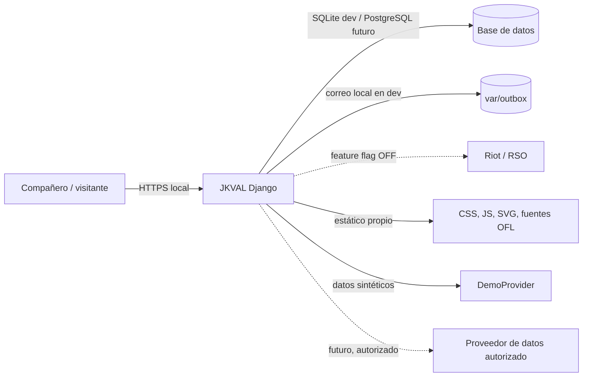
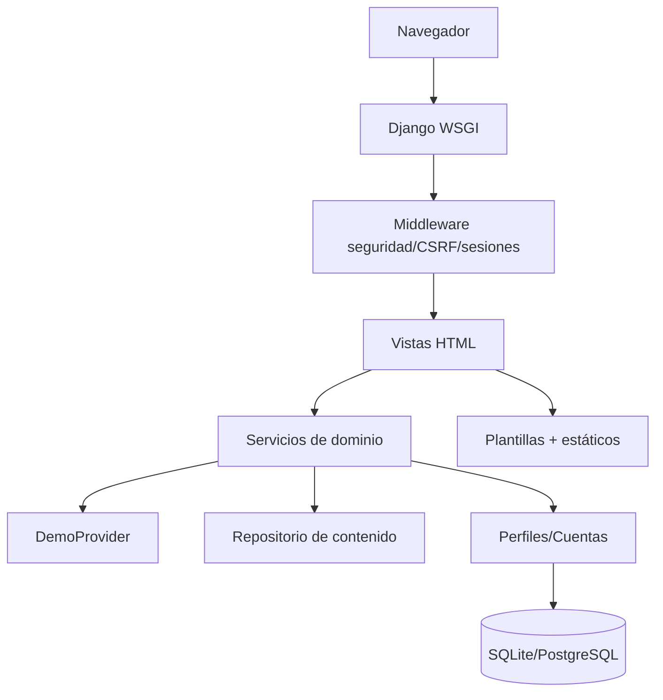

# Arquitectura — JKVAL

Fecha: 2026-10-28. Estado: Fase 0 aprobada para implementación local; revisión independiente pendiente (límite de modelos gratuitos de OpenRouter durante la sesión).

## 1. Objetivo y alcance

JKVAL es una aplicación web escolar para consultar contenido de VALORANT (portada, guías, estadísticas, perfiles y aim trainer) con identidad propia, datos etiquetados y ejecución local. No se publica, no se contrata hosting y no se usan datos reales de Riot en esta etapa.

Restricciones verificadas: no hay Node.js/npm, Docker ni Supabase CLI; sí Python 3.14.7, Django 6.1.2, SQLite 3.53.4, PostgreSQL 18 (servicio detenido), Chromium y Playwright Python. Los assets crudos ocupan 786 MB y no se versionan.

## 2. Contexto (C4 nivel 1)



## 3. Contenedores y módulos

Monolito modular Django, server-rendered, sin build de frontend.



| Módulo | Responsabilidad | Fase |
|---|---|---|
| `core` | portada, navegación, procedencia, errores, salud | 1 |
| `guides` | agentes, mapas, composiciones y consejos citados | 2 |
| `accounts` | registro, verificación, sesiones, privacidad | 3 |
| `stats` | filtros, agregados, snapshots y estados | 3 |
| `trainer` | aim trainer original y métricas locales | 4 |
| `ops` | comandos, backups, observabilidad | 5 |

Regla: `core` no importa `accounts`; las vistas consumen servicios, no consultan JSON/ORM directamente. Un `DataProvider` con implementaciones `DemoProvider` y `AuthorizedProvider` evita mezclar orígenes. Riot/RSO se controla con `FEATURE_RIOT_RSO=False`.

## 4. Flujo de datos

1. El usuario elige filtros por GET (sin JS obligatorio).
2. La vista valida contra allowlists y construye un `FilterSet`.
3. El proveedor filtra su dataset y devuelve agregados + metadatos de procedencia.
4. La plantilla renderiza uso, win rate, muestra, intervalo Wilson y estado.
5. Si no hay cobertura o muestra suficiente, muestra “No aplica” o “Datos insuficientes”; nunca infiere.
6. El dataset DEMO es estático y rotulado; no hay refresco simulado. En el futuro, un job restringido guardará snapshots y conservará la última instantánea válida.

## 5. Contrato de datos (Fase 1)

`GET /` acepta: `mode`, `rank`, `region`, `act`, `patch`, `map`, `sort`.

- `mode`: `competitive|unrated|swiftplay|deathmatch`.
- `rank`: `Ascendente|Inmortal|Radiante|all`; ignorado con aviso si el modo no tiene rango.
- `region`: `LATAM|NA|EU|APAC|all`.
- `act`: `V26 A3|V26 A2|all`; `patch`: `13.09|13.08|13.07|all`; `map`: nombre competitivo o `all`.
- `sort`: `picks|winrate`.

Respuesta de servicio (forma estable):

```json
{
  "filters": {"mode":"competitive","rank":"Inmortal","region":"all","act":"V26 A3","patch":"13.09","map":"all","sort":"picks"},
  "agents": [{"name":"Jett","role":"Duelista","picks":1234,"wins":650,"usage":8.1,"win_rate":52.7,"wilson_low":49.9,"wilson_high":55.4,"sample":1234,"insufficient":false}],
  "compositions": [{"id":"comp-01","name":"Control total","kind":"observed","usage":12.2,"win_rate":51.8,"wilson_low":49.1,"wilson_high":54.5,"sample":980,"insufficient":false}],
  "provenance": {"source":"JKVAL DemoProvider (sintético)","label":"DEMO · Datos ficticios","method":"...","patch":"13.09","period":"...","matches":5040,"picks":50400,"published_at":"...","last_checked_at":"...","status":"demo","refresh":"disabled"}
}
```

Reglas: conteos y porcentajes calculados en servidor; Wilson 95 %; umbral 200 picks por agente y 500 usos por composición; orden por uso por defecto; “mejor win rate” ordena por límite inferior de Wilson y excluye insuficientes. No se oculta el uso ni la muestra.

## 6. Modelo de datos previsto (Fase 3)

- `User`: correo único, hash de contraseña (Django), verificado, fechas, flags de privacidad.
- `Profile`: nombre visible, bio, visibilidad (`private` por defecto), consentimiento Riot, timestamps.
- `EmailVerification`: hash del token, expiración, usado; el token en claro solo en el correo local.
- `RiotLink` (desactivado): `puuid` seudónimo, consentimiento, tokens cifrados/fuera de logs.
- `StatSnapshot`: proveedor, dataset, parche, periodo, filtros, muestra, publicado_en, consultado_en, estado (`demo|static|incomplete|stale`).
- `Match/ProfileStat`: datos derivados mínimos, borrables en cascada.
- `AuditEvent`: actor, acción, resultado; sin PII ni secretos.

SQLite en desarrollo; PostgreSQL 18 en staging/producción mediante `DATABASE_URL`. Migraciones Django versionadas.

## 7. Atributos de calidad y criterios medibles

| Atributo | Escenario | Criterio Fase 1 |
|---|---|---|
| Accesibilidad | Teclado, lector, móvil | WCAG 2.2 AA en flujo principal; skip link, foco visible, contraste ≥4.5:1, intro omitible |
| Rendimiento | Primera carga local | HTML+CSS+JS inicial < 300 KB sin fuentes; LCP local < 2,5 s; sin CLS por intro |
| Seguridad | Cabeceras y entradas | CSP sin `unsafe-inline`, CSRF activo, validación server-side, errores genéricos |
| Privacidad | Navegación anónima | Sin cuentas ni cookies de terceros; solo sesión y preferencia local |
| Honestidad | Datos | 100 % de tablas con fuente, muestra, parche y estado DEMO |
| Disponibilidad | Fallo de dataset | Página de estado controlada, sin traceback ni datos inventados |
| Mantenibilidad | Cambio de proveedor | Interfaz `DataProvider` y pruebas de contrato |

## 8. Seguridad y privacidad

- CSRF de Django en toda mutación; cookies HttpOnly, SameSite=Lax, Secure en producción.
- Validación por allowlist; ORM/consultas parametrizadas; autoescape; CSP estricta; cabeceras `X-Frame-Options`, `nosniff`, `Referrer-Policy`, `Permissions-Policy`.
- Sin panel admin ni endpoint público de ingesta. `/salud/` no expone PII.
- Rate limiting y verificación de correo se implementan en Fase 3, antes de habilitar cuentas.
- Logs sin contraseñas, tokens ni correos; `.env` fuera de Git.
- Riot desactivado; nunca se pide contraseña de Riot; sin APIs privadas ni scraping de Tracker.gg.

## 9. Riesgos y mitigaciones

| Riesgo | Impacto | Mitigación |
|---|---|---|
| Sin Node/runtime JS moderno | No usar Next.js | Django + JS nativo; decisión registrada |
| Datos reales no autorizados | Afirmaciones falsas | DEMO rotulado, feature flag, sin mezcla |
| Assets sin permiso | Infracción | No publicar; arte original en Fase 1; manifiesto |
| Ausencia de revisión independiente | Hallazgos no detectados | Registrar deuda; repetir con code-reviewer/security-auditor cuando el límite lo permita |
| Muestra pequeña por filtros | Conclusiones erróneas | Umbrales + “Datos insuficientes” |
| Menores/edad | Privacidad | Bloqueo de registro hasta decisión escolar |
| PostgreSQL detenido | Sin paridad prod | SQLite dev; migración y pruebas en Fase 5 |

## 10. Evolución

Fase 1: `DemoProvider` + JSON gzip determinista, sesión DB, plantillas. Fase 3: modelos Django, auth mantenida, verificación por archivo local, snapshots y `AuthorizedProvider`. Fase 5: PostgreSQL, Gunicorn/WSGI, HTTPS, backups, observabilidad y rollback; repetir amenazas y pruebas.

## 11. Criterios de aceptación Fase 0

- [x] Entorno y capacidades verificados con comandos.
- [x] Stack decidido y justificado (ADR-001).
- [x] Flujos, módulos, contrato y modelo previsto documentados.
- [x] Modelo de amenazas, inventario de privacidad y política de assets.
- [x] Fuentes oficiales consultadas y fechadas.
- [ ] Revisión independiente de arquitectura/seguridad (bloqueada por límite de modelos gratuitos).
- [ ] Aprobación escolar sobre menores, correo y hosting (bloqueo externo).
